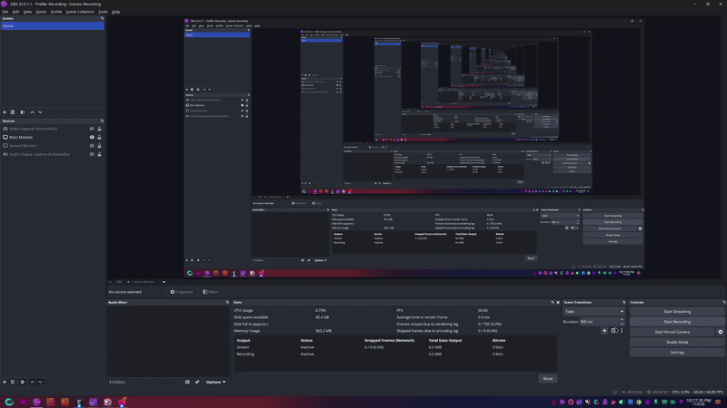

# Dock Layouts for OBS Studio

Named dock layout profiles for OBS Studio on Windows, macOS, and Linux.

OBS only has a single window layout. This plugin adds a **Dock Layouts** submenu under the **Docks** menu so you can save the current docks and window geometry under a name, then switch between profiles with one click.

## Features

- Saves dock positions, sizes, visibility, floating state, tabs, and the main window size and position.
- Switches profiles from **Docks -> Dock Layouts**.
- Includes a small manager for saving, loading, renaming, and deleting profiles.
- Warns before loading a profile that references docks which are not currently available.
- Rolls back to the previous layout if a restore fails.
- Keeps OBS's dock lock state intact when loading a profile.
- Stores profiles as readable JSON and replaces files atomically.
- Uses only OBS frontend and Qt APIs, with no platform-specific code.

## Usage

After installing and restarting OBS, open the **Docks -> Dock Layouts** menu.

- **Save Current Layout...** prompts for a name and saves the current arrangement. Saving under an existing name asks before replacing it.
- **A saved layout name** loads that layout immediately.
- **Manage Layouts...** opens a list with Save, Load, Rename, Delete, and Open Folder buttons. Double-clicking a row loads it.
- **Open Layouts Folder** shows the profile files in your file manager.

The saved layouts are also available as JSON files, so they can be backed up or copied between machines.

## Where profiles are stored

The manager shows the exact folder at the bottom of the window.

| Platform | Default folder |
| --- | --- |
| Windows | `%APPDATA%\obs-studio\plugin_config\obs-dock-layouts\layouts` |
| macOS | `~/Library/Application Support/obs-studio/plugin_config/obs-dock-layouts/layouts` |
| Linux | `~/.config/obs-studio/plugin_config/obs-dock-layouts/layouts` |

Portable OBS installations use the portable configuration directory instead.

## Building

There are no prebuilt binaries in this repository. Build the plugin on the operating system where it will run.

### Requirements

- OBS Studio 30 or newer.
- CMake 3.20 or newer.
- Qt 6.2 or newer with development files.
- OBS development files that provide the `libobs` and `obs-frontend-api` CMake packages.

The plugin is built with the same toolchain OBS uses for its own plugins. The official [OBS plugin template](https://github.com/obsproject/obs-plugintemplate) documents how to obtain the OBS and Qt build dependencies on each platform.

### Linux

Arch Linux:

```sh
sudo pacman -S --needed base-devel cmake qt6-base obs-studio
cmake -S . -B build -DCMAKE_BUILD_TYPE=Release
cmake --build build -j
cmake --install build --prefix "$HOME/.config/obs-studio/plugins/obs-dock-layouts"
```

Ubuntu or Debian:

```sh
sudo apt install build-essential cmake qt6-base-dev libobs-dev
cmake -S . -B build -DCMAKE_BUILD_TYPE=Release
cmake --build build -j
cmake --install build --prefix "$HOME/.config/obs-studio/plugins/obs-dock-layouts"
```

Fedora:

```sh
sudo dnf install cmake gcc-c++ qt6-qtbase-devel obs-studio-devel
cmake -S . -B build -DCMAKE_BUILD_TYPE=Release
cmake --build build -j
cmake --install build --prefix "$HOME/.config/obs-studio/plugins/obs-dock-layouts"
```

### macOS

Build against OBS's plugin dependencies, then:

```sh
cmake -S . -B build -G Xcode \
  -DCMAKE_PREFIX_PATH="/path/to/obs-deps;/path/to/obs-studio/build" \
  -DCMAKE_OSX_ARCHITECTURES="arm64;x86_64"
cmake --build build --config Release
cmake --install build --config Release \
  --prefix "$HOME/Library/Application Support/obs-studio/plugins"
```

### Windows

Build against OBS's plugin dependencies, then:

```bat
cmake -S . -B build -G "Visual Studio 17 2022" -A x64 ^
  -DCMAKE_PREFIX_PATH="C:/obs-deps/x64;C:/obs-studio/build"
cmake --build build --config Release
cmake --install build --config Release ^
  --prefix "%APPDATA%\obs-studio\plugins\obs-dock-layouts"
```

## Limitations

- A profile restores docks that exist in the current OBS session. It does not create missing third-party docks.
